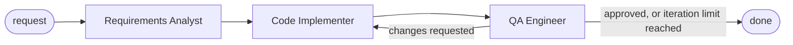

# Multi-Agent Starter Kit

A small, production-minded starting point for multi-agent systems built with
[LangGraph](https://langchain-ai.github.io/langgraph/). Three agents work through a
feature request as a mini engineering team:

| Agent | Input | Output |
|---|---|---|
| **Requirements Analyst** | Your feature request | A structured functional specification (rendered as Markdown) |
| **Code Implementer** | The specification, plus QA feedback on retries | One complete, runnable Python module |
| **QA Engineer** | The specification and the code | Validation checks, a verdict, and actionable issues |

If QA rejects the code, the implementer receives the report and tries again, up to a
configurable number of rounds.



Every agent output is a Pydantic v2 model returned through the provider's structured
output support, so the graph state always matches a strict schema.

## Requirements

- Python 3.11 or newer
- An API key for Anthropic or OpenAI

## Installation

```bash
git clone <your-fork-url> multi-agent-starter-kit
cd multi-agent-starter-kit

python -m venv .venv
source .venv/bin/activate          # Windows: .venv\Scripts\activate

pip install -e ".[dev]"
cp .env.example .env               # then add your API key
```

## Configuration

All settings are read from environment variables, or from `.env` in the directory you
run the command from. Invalid values stop the run with a clear message before any API call.

| Variable | Default | Description |
|---|---|---|
| `LLM_PROVIDER` | `anthropic` | `anthropic` or `openai` |
| `ANTHROPIC_API_KEY` | | Required when the provider is `anthropic` |
| `OPENAI_API_KEY` | | Required when the provider is `openai` |
| `LLM_MODEL` | `claude-sonnet-5-5` / `gpt-4.1` | Any chat model that supports tool calling |
| `LLM_TEMPERATURE` | model default | `0.0` to `2.0`. Leave empty unless you need it |
| `LLM_MAX_TOKENS` | `8192` | Maximum tokens per response |
| `MAX_QA_ITERATIONS` | `3` | Implement-then-QA rounds before giving up (1 to 10) |
| `LOG_LEVEL` | `INFO` | `DEBUG`, `INFO`, `WARNING` or `ERROR` |

## Usage

```bash
agentkit run "Build a command-line calculator"
```

`agentkit` is installed by `pip install -e .`. Without installing, run the module
directly from the project root:

```bash
python -m src.main run "Build a command-line calculator"
```

Options:

| Option | Description |
|---|---|
| `-o, --output-dir DIR` | Also write `SPEC.md`, the generated module and `QA_REPORT.md` to `DIR` |
| `-v, --verbose` | Debug logging, including the full specification and HTTP activity |
| `--help` | Show help for a command |

Example:

```bash
agentkit run "A CLI that converts temperatures between Celsius, Fahrenheit and Kelvin" -o output/
```

While the graph runs, a spinner shows which agent is working and log lines report each
step. The results are then printed: the specification, the syntax-highlighted code, a
table of QA checks, and the final verdict.

Results go to **stdout**; the spinner and logs go to **stderr**. You can redirect or pipe
the results without capturing the progress noise.

### Exit codes

| Code | Meaning |
|---|---|
| `0` | QA approved the code |
| `1` | Configuration, LLM or file-system error |
| `2` | Pipeline finished, but QA did not approve within `MAX_QA_ITERATIONS` |

These make the command usable in scripts and CI.

## How QA validates code

The QA agent never executes generated code. It works in two stages:

1. **Static gate:** the code is parsed with Python's `ast` module. A syntax error is
   sent straight back to the implementer, and no LLM call is spent on review.
2. **Simulated tests:** the model derives 4 to 8 checks from the acceptance criteria
   and edge cases, traces the code by hand for each one, and records pass or fail.

The code counts as approved only when the model says so **and** every check passes,
so a contradictory report ("approved" with a failing check) is treated as a rejection.

## Project layout

```text
├── pyproject.toml          Dependencies, the agentkit script and the pytest config
├── .env.example            Configuration template
├── src/
│   ├── main.py             Typer CLI, graph wiring, progress display, result rendering
│   ├── state.py            Pydantic output models and the LangGraph PipelineState
│   ├── config.py           Settings loaded and validated from the environment
│   ├── errors.py           Custom exception hierarchy
│   ├── agents/
│   │   ├── analyst.py      Feature request -> Specification
│   │   ├── implementer.py  Specification (+ QA feedback) -> CodeArtifact
│   │   └── qa.py           Specification + CodeArtifact -> QAReport
│   └── utils/
│       ├── logger.py       Rich logging setup
│       └── llm.py          Chat-model factory and structured-output helper
└── tests/
    └── test_pipeline.py    Offline tests of the full graph with a scripted model
```

### Graph state

`PipelineState` (in `src/state.py`) carries:

| Key | Type | Written by |
|---|---|---|
| `prompt` | `str` | The CLI |
| `specification` | `Specification` | Analyst |
| `code` | `CodeArtifact` | Implementer |
| `qa_report` | `QAReport` | QA |
| `iteration` | `int` | Implementer, which counts its own attempts |
| `active_node` | `"analyst" \| "implementer" \| "qa"` | Every agent, naming itself |

## Extending the kit

**Change an agent's behaviour:** edit `SYSTEM_PROMPT` in its module, or add fields to its
output model in `src/state.py`. Field descriptions are sent to the model as part of the
schema, so they act as instructions.

**Add an agent,** for example a documentation writer that runs after approval:

1. Add an output model in `src/state.py` and a matching key in `PipelineState`.
2. Create `src/agents/docs_writer.py` with a `build_docs_writer(llm)` factory, following
   the same pattern as the existing agents.
3. Register it in `build_graph()` in `src/main.py`, and point the QA router's approval
   branch at it instead of `END`.
4. Add a status message for it in `describe_progress()`.

**Add a provider:** add a branch to `create_chat_model()` in `src/utils/llm.py`, plus
entries in `DEFAULT_MODELS` and `API_KEY_VARIABLES` in `src/config.py`.

## Testing

```bash
pytest
```

The tests replace the LLM with a scripted stand-in, so they run offline in about a second.
They cover the QA retry loop, the iteration limit, the syntax-error gate, approval
consistency, error wrapping and generated-filename sanitizing.

## Troubleshooting

| Symptom | Fix |
|---|---|
| `ANTHROPIC_API_KEY is not set` | Add the key to `.env`, or run from the directory that contains `.env` |
| `Invalid configuration ... LLM_PROVIDER` | Use lowercase `anthropic` or `openai` |
| `LLM call failed: ... temperature` | Leave `LLM_TEMPERATURE` empty for that model |
| `model did not return a valid ...` | The model does not support tool calling well; pick a stronger `LLM_MODEL` |
| Code is cut off and QA reports a `SyntaxError` | Raise `LLM_MAX_TOKENS` |
