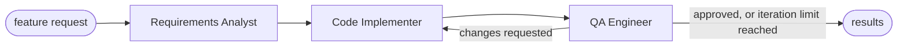

# Multi-Agent Starter Kit

A production-minded starting point for multi-agent systems built with
[LangGraph](https://langchain-ai.github.io/langgraph/). Give it a feature request in plain
English and three agents work through it like a small engineering team: one writes the
spec, one writes the code, and one reviews and tests it, sending it back until it passes.

```bash
agentkit run "Build a command-line calculator" --execute -o output/
```

## Contents

- [How it works](#how-it-works)
- [Quick start](#quick-start)
- [Testing for free with Groq](#testing-for-free-with-groq)
- [Configuration](#configuration)
- [Usage](#usage)
- [How QA validates code](#how-qa-validates-code)
- [Security](#security)
- [Project layout](#project-layout)
- [Extending the kit](#extending-the-kit)
- [Development](#development)
- [Known limitations](#known-limitations)
- [Troubleshooting](#troubleshooting)
- [License](#license)

## How it works

| Agent | Receives | Produces |
|---|---|---|
| **Requirements Analyst** | Your feature request | A functional specification: requirements, interface, edge cases, acceptance criteria and assumptions |
| **Code Implementer** | The specification, plus the QA report on retries | One complete, runnable Python module |
| **QA Engineer** | The specification and the code | 5 to 10 checks with pass or fail, a runnable test script, a verdict and actionable issues |



Every agent returns a Pydantic v2 model through the provider's structured-output support,
so the shared graph state always matches a strict schema. If QA rejects the code, the
implementer gets the full report, including real test output when `--execute` is on,
and tries again, up to `MAX_QA_ITERATIONS` times.

## Quick start

Requires **Python 3.11+** and an API key for Anthropic, OpenAI, or any OpenAI-compatible
provider (see [free testing](#testing-for-free-with-groq)).

```bash
git clone <your-repo-url> multi-agent-starter-kit
cd multi-agent-starter-kit

python -m venv .venv
source .venv/bin/activate              # Windows: .venv\Scripts\activate
pip install -e ".[dev]"

cp .env.example .env                   # then add your API key
agentkit run "Build a command-line calculator"
```

`pip install -e .` installs the `agentkit` command. Without installing it, you can run
`python -m src.main run "..."` from the project root instead.

## Testing for free with Groq

Anthropic and OpenAI need paid credit. [Groq](https://console.groq.com) has a free tier
with no card required and an OpenAI-compatible API, so it works through the `openai`
provider:

```env
LLM_PROVIDER=openai
OPENAI_API_KEY=gsk_your_groq_key
OPENAI_BASE_URL=https://api.groq.com/openai/v1
LLM_MODEL=openai/gpt-oss-120b
LLM_MAX_RETRIES=6
```

Groq's free tier allows about 8,000 tokens per minute, and one QA request can use most of
that. The client waits out each rate limit and retries, so a full three-round run takes
about three minutes. Other OpenAI-compatible providers work the same way:

| Provider | `OPENAI_BASE_URL` | Notes |
|---|---|---|
| Groq | `https://api.groq.com/openai/v1` | Free tier; tested with `openai/gpt-oss-120b` |
| Google Gemini | `https://generativelanguage.googleapis.com/v1beta/openai/` | Free tier; key from aistudio.google.com |
| OpenRouter | `https://openrouter.ai/api/v1` | Pick a model ending in `:free` |
| Ollama (local) | `http://localhost:11434/v1` | No key needed: set `OPENAI_API_KEY=ollama` |

Only Groq has been tested end to end. The model must support tool calling or JSON-schema
output; small local models often produce invalid structured output.

## Configuration

Settings come from environment variables, or from a `.env` file found by searching upward
from the directory you run the command in. Real environment variables take precedence.
Invalid values stop the run with a clear message before any API call is made.

| Variable | Default | Description |
|---|---|---|
| `LLM_PROVIDER` | `anthropic` | `anthropic` or `openai` (also used for OpenAI-compatible APIs) |
| `ANTHROPIC_API_KEY` | | Required when the provider is `anthropic` |
| `OPENAI_API_KEY` | | Required when the provider is `openai` |
| `OPENAI_BASE_URL` | OpenAI | Address of an OpenAI-compatible API. Leave it out entirely for OpenAI itself: an empty value breaks the client |
| `LLM_MODEL` | `claude-sonnet-5-5` / `gpt-4.1` | Any chat model that supports tool calling |
| `LLM_TEMPERATURE` | model default | `0.0` to `2.0`. Leave empty unless you need it; some models reject it |
| `LLM_MAX_TOKENS` | `8192` | Maximum tokens per response |
| `LLM_MAX_RETRIES` | `6` | Retries for failed or rate-limited calls, 0 to 20 |
| `MAX_QA_ITERATIONS` | `3` | Implementer-then-QA rounds before stopping, 1 to 10 |
| `LOG_LEVEL` | `INFO` | `DEBUG`, `INFO`, `WARNING` or `ERROR` |

## Usage

```bash
agentkit run [OPTIONS] REQUEST
```

| Option | Description |
|---|---|
| `-x, --execute` | Run QA's test script against the generated code (see [Security](#security)) |
| `-o, --output-dir DIR` | Write `SPEC.md`, the module, its test script and `QA_REPORT.md` to `DIR` |
| `-v, --verbose` | Debug logging, including the full specification and HTTP activity |
| `--help` | Show help |

Examples:

```bash
agentkit run "A CLI that converts temperatures between Celsius, Fahrenheit and Kelvin"
agentkit run "A function that validates IBAN numbers" --execute -o output/iban
agentkit run "A word-frequency counter for text files" -v
```

While it runs, a spinner shows which agent is working and log lines report each step:

```text
INFO  src.agents.analyst: Specification ready: 'Command-line Calculator' with 8 requirements and 7 acceptance criteria
INFO  src.agents.implementer: Produced calc.py (98 lines)
INFO  src.agents.qa: Executed QA test script: failed
INFO  src.agents.qa: QA verdict: changes requested (7/9 checks passed, 3 issues)
INFO  src.agents.implementer: Writing implementation, iteration 2
```

The results follow: the specification, the syntax-highlighted code, a table of QA
checks, and a verdict panel. The verdict says whether the tests were actually run or
only reviewed.

Results go to **stdout**, and the spinner and logs go to **stderr**, so you can redirect
the results without capturing progress output.

### Exit codes

| Code | Meaning |
|---|---|
| `0` | QA approved the code |
| `1` | Configuration, LLM or file-system error |
| `2` | QA did not approve, either within `MAX_QA_ITERATIONS` or before a later LLM call failed. Results from the last reviewed round are still shown and saved |

## How QA validates code

QA runs up to three layers. Each one can reject the code and send it back with feedback:

1. **Static gate.** The code is parsed with Python's `ast` module. A syntax error goes
   straight back to the implementer without spending a review call.
2. **Review.** The model derives 5 to 10 checks: every acceptance criterion, plus
   malformed, boundary and oversized inputs. It traces the code by hand and records pass
   or fail for each. It also flags APIs that are deprecated or removed in the Python
   version you run.
3. **Execution** (`--execute` only). QA's test script is actually run against the module.
   Any failure, crash or hang rejects the code, and the real traceback goes to the
   implementer. If QA's own script does not even parse, it is discarded and the review
   verdict stands, because a broken test must not count against the implementer. The
   verdict then reads *review only, not executed*.

The code counts as approved only when the model approves it **and** every check passes,
and with `--execute`, when the test script also passes. Without `--execute`, QA's verdict
is the model's judgement alone, and it can approve code that crashes on inputs it never
traced. Use `--execute` when the result matters.

Every QA report includes the test script whether or not it was run, and `-o` saves it as
`test_<module>.py` so you can run it yourself.

## Security

**`--execute` runs code written by a language model on your machine.** It is a
convenience, not a sandbox. The safeguards are:

- The code runs in a fresh temporary directory that is deleted afterwards.
- The child process gets only `PATH`, `HOME`, `LANG`, `TMPDIR` and `SYSTEMROOT` from your
  environment, so it **cannot read your API keys**.
- A 30-second timeout kills the whole process group, including anything the test
  started.
- Standard input is closed, so the code cannot wait for input.

There is **no** network, filesystem or memory isolation: the code runs with your user's
permissions. For untrusted requests, run the kit inside a container or a VM.

Other safeguards, which apply to every run:

- The module filename comes from the model, so it is reduced to a bare
  `name.py` before anything is written, and it cannot escape `--output-dir`.
- Model output is escaped before the terminal renders it, so it cannot inject formatting.
- `.env` is listed in `.gitignore`. Never commit it, and rotate any key that has been
  pasted somewhere public.

## Project layout

```text
├── pyproject.toml           Dependencies, the agentkit command and pytest config
├── .env.example             Configuration template with every setting documented
├── src/
│   ├── main.py              Typer CLI, graph wiring, progress display and rendering
│   ├── state.py             Pydantic output models and the LangGraph PipelineState
│   ├── config.py            Settings loaded and validated from the environment
│   ├── errors.py            Custom exception hierarchy
│   ├── agents/
│   │   ├── analyst.py       Feature request -> Specification
│   │   ├── implementer.py   Specification (+ QA report) -> CodeArtifact
│   │   └── qa.py            Specification + CodeArtifact -> QAReport
│   └── utils/
│       ├── llm.py           Chat-model factory and structured-output helper
│       ├── executor.py      Runs QA test scripts in a subprocess
│       └── logger.py        Rich logging setup
└── tests/
    ├── test_pipeline.py     Full-graph tests with a scripted model
    └── test_executor.py     Execution, timeout and secret-isolation tests
```

### Graph state

`PipelineState` in `src/state.py`:

| Key | Type | Written by |
|---|---|---|
| `prompt` | `str` | The CLI |
| `specification` | `Specification` | Analyst |
| `code` | `CodeArtifact` | Implementer |
| `qa_report` | `QAReport` | QA |
| `iteration` | `int` | Implementer, counting its own attempts |
| `active_node` | `"analyst" \| "implementer" \| "qa"` | Each agent, naming itself |

## Extending the kit

**Change an agent's behaviour.** Edit `SYSTEM_PROMPT` in its module, or add fields to its
output model in `src/state.py`. Field descriptions are sent to the model as part of the
schema, so they work as instructions.

**Add an agent,** for example a documentation writer that runs after approval:

1. Add its output model in `src/state.py` and a matching key in `PipelineState`.
2. Create `src/agents/docs_writer.py` with a `build_docs_writer(llm)` factory that follows
   the existing agents.
3. Register it in `build_graph()` in `src/main.py`, and point the approval branch of
   `route_after_qa` at it instead of `END`.
4. Add a status message for it in `describe_progress()`.

**Add a provider.** Add a branch to `create_chat_model()` in `src/utils/llm.py`, and
entries to `DEFAULT_MODELS` and `API_KEY_VARIABLES` in `src/config.py`. For any
OpenAI-compatible API, setting `OPENAI_BASE_URL` is enough.

## Development

```bash
pip install -e ".[dev]"
pytest
```

The 18 tests run offline in a few seconds, with no API key. A scripted stand-in replaces
the LLM. They cover the QA retry loop, the iteration limit, the syntax gate, approval
consistency, error wrapping, keeping the last reviewed round when a later call fails,
filename sanitizing, and the executor: real failures, timeouts that kill child processes,
API keys hidden from generated code, and broken QA scripts not blamed on the implementer.

## Known limitations

- **QA coverage depends on the model.** QA tests what it thinks to test. In real runs it
  caught crashes and hangs, but it still missed rare inputs such as `(-2)**0.5` in a
  calculator. Review generated code before you rely on it.
- **QA's tests can be wrong too.** A test that is stricter than the spec, such as one
  that demands exact error wording, can reject correct code until the iteration limit.
  The run then exits with code `2`, and you can read the test failure in the verdict.
- **Single module only.** The implementer writes one self-contained file, not a package.
- **Free tiers cap request size.** Retry prompts carry the spec, the previous code and the
  failed checks, so they grow each round. On Groq's free tier a late round can exceed the
  per-minute token limit (`413 Request too large`). The kit then logs the error and keeps
  the last round QA fully reviewed, so earlier work is not lost.

## Troubleshooting

| Symptom | Fix |
|---|---|
| `ANTHROPIC_API_KEY is not set` | Add the key to `.env`, or run from the directory that contains `.env` |
| `Invalid configuration ... LLM_PROVIDER` | Use lowercase `anthropic` or `openai` |
| `Error code: 429 ... Rate limit reached` | Raise `LLM_MAX_RETRIES`, lower `MAX_QA_ITERATIONS`, or wait a minute between runs |
| `Error code: 413 ... Request too large` | One request exceeds the provider's per-minute limit, so retrying cannot help. Set `MAX_QA_ITERATIONS=2`, or use a paid tier |
| `LLM call failed: ... temperature` | Leave `LLM_TEMPERATURE` empty for that model |
| `model did not return a valid ...` | The model handles structured output poorly; pick a stronger `LLM_MODEL` |
| OpenAI calls fail after removing Groq | Delete the `OPENAI_BASE_URL` line entirely; don't leave it empty |
| Code is cut off and QA reports a `SyntaxError` | Raise `LLM_MAX_TOKENS` |
| QA rejects good code with a strict assertion | Read the test failure in the verdict, and make the requirement explicit in your request |

## License

[MIT](LICENSE)
